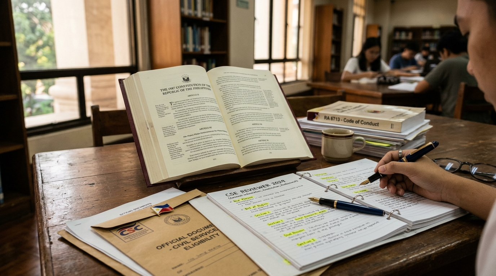

# CSE Topnotcher — Philippine Civil Service Exam (CSE) Reviewer 🇵🇭

Isang komprehensibong web application para sa paghahanda sa **Philippine Civil Service Commission (CSC) Career Service Examination** (Professional at Sub-Professional levels).



---

## 🌟 Mga Tampok (Key Features)

### 1. Libreng Sample Questions at Premium Question Bank
May 65 libreng sample questions na hinati sa 5 opisyal na subtests. Ang dagdag na Premium questions ay nasa pribadong Firestore collection at hindi kasama sa public source files:
- **Kakayahang Pamilang (Numerical Ability - 13 Qs)**: Word Problems (Age, Work, Distance, Mixture, Percentages, Profit/Loss), Number Sequences, Fractions, at Data Interpretation.
- **Kakayahang Mapanuri (Analytical Ability - 13 Qs)**: Syllogisms, Word Association, Analogy, Logical Deduction, Assumptions, at Data Sufficiency.
- **Kakayahang Berbal (Verbal Ability - 13 Qs)**: Grammar & Correct Usage, Subject-Verb Agreement, Synonyms & Antonyms, Paragraph Organization, at Reading Comprehension.
- **Pangkalahatang Kaalaman (General Information - 13 Qs)**: 1987 Konstitusyon ng Pilipinas (Bill of Rights, Accountability, Constitutional Commissions), Republic Act 6713 (Code of Conduct and Ethical Standards for Public Officials and Employees), Karapatang Pantao, at Environmental Management (RA 9003, Clean Air Act).
- **Kakayahang Pang-Klerikal (Clerical Ability - 13 Qs)**: Alphabetical Indexing Rules, Filing Systems, Clerical Reasoning, Error Checking, at Spelling.

### 2. Opisyal na 'Simulated Exam' Feature (CSC Blueprint)
- **Professional Level**: Eksaktong 170 items sa loob ng 3 oras at 10 minuto (190 mins).
- **Sub-Professional Level**: Eksaktong 165 items sa loob ng 2 oras at 40 minuto (160 mins).
- **Interactive Scantron OMR Sheet**: Maaaring mag-shade ng bilog (A, B, C, D) katulad ng sa aktuwal na pagsusulit.
- **Proctor Countdown Clock**: May awtomatikong audio bell at babala sa natitirang 30 mins, 15 mins, at 5 mins.
- **Opisyal na Report of Rating**: Awtomatikong bumubuo ng opisyal na pagsusuri ng marka batay sa **80.00% passing threshold** ng CSC.

### 3. Awtomatikong Scoring at Detalyadong Paliwanag
- May breakdown ng marka bawat subseksyon na may kasamang CSC standard weights.
- **Detalyadong Paliwanag**:
  - Hakbang-sa-hakbang na solusyon sa math (*step-by-step calculation*).
  - Batayan sa batas (*Constitutional Article* at *RA 6713 Section* citations) o tuntunin sa balarila.
  - Pagsusuri kung bakit mali ang ibang pagpipilian (*distractor analysis*).

### 4. Spaced Repetition Reviewer (Balikan ang mga Maling Sagot)
- Awtomatikong iniipon ang bawat tanong na iyong naipagkamali.
- May interactive flashcard mode na may *"Kabisado Ko Na (Mastered)"* button.

### 5. Pambansa at Rehiyonal na Leaderboard
- Top 3 Podium (Gold, Silver, Bronze) at pagraranggo sa 17 rehiyon ng Pilipinas (NCR, CALABARZON, Central Luzon, Visayas, Mindanao, atbp.).
- Nako-customize na profile ng Examinee (Pangalan, Rehiyon, Antas, at Avatar).

### 6. Daily Streak Counter
- Animated fire icon at 7-day mini-calendar tracker upang hikayatin ang araw-araw na pag-aaral.

### 7. Web Audio Synthesizer
- Zero external audio assets; gumagamit ng procedural Web Audio API para sa chimes, countdown ticking, combo streaks, at passing fanfare.

---

## 🛠️ Tech Stack

- **Framework**: React 19 + TypeScript
- **Bundler**: Vite 8
- **Styling**: Tailwind CSS v4 (with Dark Mode support)
- **Icons**: Lucide React
- **Audio**: Web Audio API (procedural synthesized sounds)
- **Storage**: Browser LocalStorage para sa profile, leaderboard records, test history, at bookmarks

---

## 🚀 Paano Patakbuhin (Getting Started)

### 1. I-clone ang Repository
```bash
git clone https://github.com/<your-username>/<your-repo-name>.git
cd <your-repo-name>
```

### 2. I-install ang Dependencies
```bash
npm install
```

### 3. Patakbuhin ang Development Server
```bash
npm run dev
```
Buksan ang browser sa `http://localhost:3000`.

### 4. I-build para sa Production
```bash
npm run build
```

## Premium payments (Firebase setup)

The app includes a ₱250 manual GCash payment request screen and an admin review screen. A Firebase project is required before these screens can be used.

1. Create a Firebase project, add a Web App, and copy its public web configuration to `.env.local` using `.env.example` as a template. Set `VITE_GCASH_ACCOUNT_NAME` and `VITE_GCASH_NUMBER` to the merchant details customers should pay.
2. In Firebase Authentication, enable Email/Password sign-in and create the Firestore database. The current GCash flow asks buyers to submit the transaction reference; it does not upload receipt screenshots, so Firebase Storage is not required. Email verification is required before a buyer can submit a request.
3. Install Firebase CLI, select the project with `firebase use --add`, then deploy the included Firestore security rules with `firebase deploy --only firestore:rules`.
4. Create an Email/Password account in the app using the admin email shown in `VITE_FIREBASE_ADMIN_EMAIL`, then verify that email. The verified account is the admin in Firestore rules; if you change the email, update the matching email in `firestore.rules` too. Never put service-account credentials in this repository or a `VITE_` variable.
5. Run the app with `npm install` then `npm run dev`.

Payment approvals write a `premium: true` entitlement to the user's Firestore record. Firestore rules reserve that field for admins. The interface locks full exams and detailed explanations for free accounts, but question data is still included in the public app bundle; these client-side gates are a starter flow, not tamper-proof content protection. No payment is processed automatically; an admin must compare the reference with GCash transaction history before approval.

---

## 📜 Lisensya
Apache-2.0 License.
Inihanda para sa mga Pilipinong kukuha ng Civil Service Examination. Mabuhay ang Kawani ng Gobyerno!


